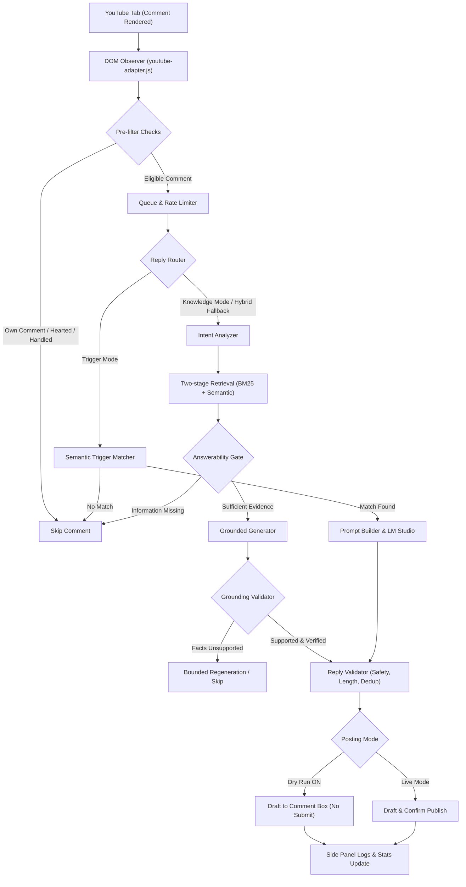

<div align="center">


# YouTube Auto Reply

**Local-First AI Comment Assistant for YouTube Creators**  
**إضافة كروم مفتوحة المصدر للرد الذكي والآلي على تعليقات يوتيوب باستخدام نماذج ذكاء اصطناعي محلية**

[](LICENSE)
[](src/manifest.json)
[-7c3aed.svg)](https://lmstudio.ai)
[](#developer-guide--testing)
[](#safety--limits)

[Summary](#-summary--at-a-glance) •
[Features](#-key-features--المميزات-الرئيسية) •
[Architecture](#-architecture--pipeline) •
[Knowledge Base](#-custom-knowledge-base) •
[Quickstart](#-quickstart--دليل-التثبيت) •
[Testing](#-developer-guide--testing)

</div>

---

## ✨ Summary — At a Glance

**YouTube Auto Reply** is an open-source **Chrome Manifest V3** extension that helps YouTube creators draft and publish context-aware replies to viewer comments using a **local LLM** (via [LM Studio](https://lmstudio.ai) or any OpenAI-compatible server at `http://localhost:1234/v1`).

- **100% Local & Private:** Comments and knowledge files never leave your machine—no cloud APIs, no subscriptions, and zero telemetry.
- **Zero-Dependency Pure ES Modules:** No bundler, no `node_modules`, no build step—load `src/` directly in Chrome.
- **Built for Arabic & English:** Includes Arabic normalization (Egyptian dialect & MSA, diacritics, and Eastern/Western numerals) alongside English.
- **Evidence-Grounded RAG (No Hallucinations):** Answers questions from your own local Markdown (`.md`) folder using two-stage retrieval, an answerability gate, and strict numeric/fact grounding validation.
- **Safe by Default:** Ships with **Dry Run** enabled (drafts replies into the comment box without clicking Submit), hourly rate limits, random human-like delays, creator-heart filtering, and anti-repetition checks.

> **باختصار:** إضافة كروم مجانية ومفتوحة المصدر تساعد صناع المحتوى على الرد على تعليقات يوتيوب بسرعة ودقة باستخدام الذكاء الاصطناعي **محلياً على جهازك بالكامل** عبر LM Studio، مع دعم متفوق للغة العربية والإنجليزية، ونظام قاعدة معرفة (`.md`) يمنع الهلوسة أو اختراع الأسعار، ووضع معاينة آمن (**Dry Run**) مفعل افتراضياً.

---

## 🚀 Key Features — المميزات الرئيسية

| Feature | Description | الوصف |
|---|---|---|
| **Multi-Mode Reply Engine** | **Trigger**, **Knowledge (RAG)**, **Hybrid**, and **Fixed Reply** modes | أنماط رد متعددة: كلمات مشغلة، قاعدة معرفة، هجين، وردود ثابتة |
| **Anti-Hallucination Gates** | Intent analysis, sufficiency gate, and numeric/fact grounding validator | بوابات تحقق تمنع اختراع الأسعار أو التواريخ أو المعلومات غير المذكورة |
| **Creator Interaction Aware** | Skips creator-hearted comments, detects existing owner replies, optional target-reply hearting, and **Answered Follow-ups** board | تخطي التعليقات ذات القلب، كشف ردود صاحب القناة، واقتراح متابعة للتعليقات المجابة |
| **Channel Safety & Limits** | Dry Run default, rolling hourly cap, random delays, banned phrases, and cross-comment anti-repetition | حماية القناة: وضع تجريبي افتراضي، حد ساعي، تأخير عشوائي، وحظر التكرار |
| **Persistent Side Panel** | Always-open Chrome Side Panel with live stats, LM Studio status, and follow-up drafts | لوحة جانبية دائمة لمتابعة الإحصائيات وحالة الخادم ومسودات المتابعة |

---

## 🏗 Architecture & Pipeline

The extension runs as pure ES modules in Chrome Manifest V3 (`src/background/`, `src/core/`, `src/popup/`, `src/options/`) paired with classic content scripts (`src/content/`) on YouTube:



---

## 📚 Custom Knowledge Base

> [!IMPORTANT]
> **Your private knowledge base is not bundled in this repository.**  
> A ready-to-use template folder is included at [`knowledge.example/`](knowledge.example/) so you can copy it and add your own `.md` files immediately.

1. **Create your local knowledge folder:**
   ```bash
   cp -r knowledge.example my-knowledge
   ```
2. **Organize your `.md` files with clear headings** (the retriever indexes both the heading path and body):
   ```markdown
   # Advanced Programming Book

   ## Price (Print & Digital)
   The printed edition is 250 EGP, and the digital edition is 150 EGP.

   ## Shipping & Delivery
   Delivery is available to all governorates within 3 business days.
   ```
3. **Link it in the extension:**
   - Open **Options** → **Knowledge** → **Folder** → click **Choose folder…** and select `my-knowledge`.
   - Grant read permission when prompted, then click **Sync now**.
   - Edits to `.md` files sync automatically every 5 minutes or on demand via **Sync now**.

---

## ⚡ Quickstart — دليل التثبيت

### 1. Start your local LLM server (LM Studio)
1. Open [LM Studio](https://lmstudio.ai) and load a model (e.g., `qwen2.5`, `gemma-2`, or `llama-3.1`).
2. Go to the **Developer** (Local Server) tab and click **Start Server** on `http://localhost:1234`.

### 2. Load the extension in Chrome
1. Clone or download this repository (click **Code → Download ZIP** on GitHub, or clone via git):
   ```bash
   git clone <repository-url>
   cd youtube-auto-reply
   ```
2. Open `chrome://extensions/` in Chrome (or Brave/Edge).
3. Enable **Developer mode** (top-right toggle).
4. Click **Load unpacked** and select the **`src/`** folder (not the repo root).

> [!NOTE]
> Always select **`src/`** when loading unpacked—that is where [`src/manifest.json`](src/manifest.json) lives.

### 3. Configure & Test
1. Pin **YouTube Auto Reply** to your Chrome toolbar and click the icon to open the **Side Panel**.
2. Click **Open settings**, choose your loaded **Model**, and click **Test Connection**.
3. Keep **Dry Run** enabled while testing on a YouTube video—you will see drafted replies appear in the comment box without being submitted.

---

## 🎛 Reply Modes

Switch between modes anytime in **Options**:

| Mode | How It Works | Best For |
|---|---|---|
| **Trigger** | Matches viewer intent against your custom trigger rules, then generates a reply (or uses a fixed reply). | Common recurring intents with tailored responses. |
| **Knowledge** | Retrieves evidence exclusively from your linked Markdown files and validates every fact/number before replying. | Product specs, pricing, courses, and detailed FAQs. |
| **Hybrid (Recommended)** | Checks **Triggers** first; if none match, falls back to **Knowledge Mode**. | Combining fast trigger rules with full knowledge-base coverage. |

---

## 🛡 Safety & Limits

- **Dry Run Mode (Default ON):** Drafts replies into the YouTube reply box without clicking Submit so you can review output quality first.
- **Rolling Hourly Cap:** Limits replies per hour (default `30/hr`) to keep activity natural.
- **Random Inter-Comment Delay:** Waits `8s–20s` (configurable) between replies.
- **Banned Phrases & Validation:** Blocks empty replies, reasoning leaks, code fences, placeholders, and forbidden phrases.
- **Anti-Repetition:** Prevents sending near-identical replies across different comments.

---

## 🧪 Developer Guide & Testing

This repository includes **40+ automated test suites** run in headless Chrome over CDP plus a packaging/invariant verifier:

### Project Structure
```text
youtube-auto-reply/
├── src/                      # Extension root (Load unpacked target)
│   ├── manifest.json         # Manifest V3 definition
│   ├── icons/                # Extension icons (16, 48, 128px)
│   ├── background/           # Service worker & LM Studio API client
│   ├── core/                 # Platform-agnostic logic, RAG, safety, tests
│   ├── content/              # YouTube DOM adapter & classic content scripts
│   ├── options/              # Options page UI
│   └── popup/                # Chrome Side Panel UI
├── knowledge.example/        # Sample Markdown knowledge base
├── scripts/
│   ├── run-tests.mjs         # Headless Chrome test runner (40 suites)
│   ├── verify-extension.mjs  # Invariant & packaging verifier (69 checks)
│   └── package.sh            # Builds dist/youtube-auto-reply-<version>.zip
├── docs/                     # Architecture & security review docs
├── LICENSE                   # MIT License
└── README.md
```

### Run Tests & Verification
```bash
# Run all 40 test suites in headless Chrome
node scripts/run-tests.mjs

# Run a specific suite by path fragment
node scripts/run-tests.mjs knowledge

# Run packaging & invariant checks
node scripts/verify-extension.mjs

# Build installable ZIP in dist/
bash scripts/package.sh
```

---

## 🔧 Troubleshooting

- **Models list is empty / "Unable to load models":** Ensure LM Studio is running and its Local Server is active at `http://localhost:1234`.
- **Replies are typed into the box but not posted:** **Dry Run** is enabled (check the Side Panel). Disable Dry Run in Options when you are ready for live posting.
- **Extension stopped replying mid-session:** You likely reached the **Max replies / hour** cap; it resumes automatically as the rolling window clears.
- **Need detailed logs:** Enable **Diagnostics logging** under *Options → Safety & limits*, reload the YouTube tab, and inspect the Service Worker console in `chrome://extensions/`.

---

## 📄 License

Released under the **[MIT License](LICENSE)** — free for personal and commercial use, modification, and distribution.
