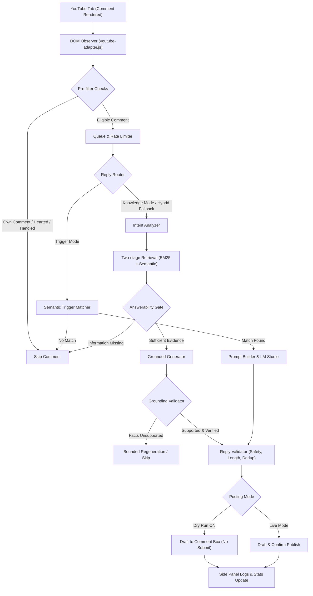

# YouTube Auto Reply 🤖⚡

> **إضافة كروم مفتوحة المصدر للرد الذكي والآلي على تعليقات يوتيوب باستخدام نماذج ذكاء اصطناعي تعمل محلياً على جهازك.**  
> An open-source Chrome extension that replies to YouTube comments automatically, powered by **local LLMs** (via [LM Studio](https://lmstudio.ai) or any OpenAI-compatible local server).  
> **100% Private & Local: بياناتك وتعليقات قناتك لا تغادر جهازك أبداً.**

---

[](LICENSE)
[](src/manifest.json)
[-purple.svg)](https://lmstudio.ai)
[](#privacy--safety)

---

## 📑 جدول المحتويات / Table of Contents

- [نبذة عن المشروع (Overview)](#نبذة-عن-المشروع-overview)
- [المميزات الرئيسية (Key Features)](#المميزات-الرئيسية-key-features)
- [كيف يعمل المشروع هندسياً (Architecture & Pipeline)](#كيف-يعمل-المشروع-هندسيا-architecture--pipeline)
- [إضافة قاعدة المعرفة الخاصة بك (Custom Knowledge Base)](#إضافة-قاعدة-المعرفة-الخاصة-بك-custom-knowledge-base)
- [دليل التثبيت والتشغيل السريع (Quickstart)](#دليل-التثبيت-والتشغيل-السريع-quickstart)
- [أنماط الرد (Reply Modes)](#أنماط-الرد-reply-modes)
- [الأمان وحماية القناة (Safety & Limits)](#الأمان-وحماية-القناة-safety--limits)
- [لوحة التحكم الجانبية (Side Panel)](#لوحة-التحكم-الجانبية-side-panel)
- [دليل المطورين والاختبارات (Developer Guide & Testing)](#دليل-المطورين-والاختبارات-developer-guide--testing)
- [استكشاف الأخطاء وحلها (Troubleshooting)](#استكشاف-الأخطاء-وحلها-troubleshooting)

---

## نبذة عن المشروع (Overview)

تم بناء هذه الإضافة لمساعدة صناع المحتوى والشركات وأصحاب القنوات التعليمية والتجارية على يوتيوب في الرد على استفسارات المتابعين والجمهور بدقة وسرعة وبشكل طبيعي تماماً:
- **محلي بالكامل (Local-first):** تتصل الإضافة بنموذج الذكاء الاصطناعي العامل على جهازك عبر `http://localhost:1234/v1` (مثل LM Studio أو Ollama)، دون إرسال التعليقات إلى خوادم سحابية وبدون اشتراكات أو رسوم API.
- **دعم متفوق للغة العربية والإنجليزية:** معالجة خاصة للهجة المصرية، الفصحى، وتطبيع الحروف وعلامات الترقيم والأرقام الهندية/العربية.
- **نظام استرجاع معرفي مدعوم بالأدلة (RAG):** تجيب الإضافة على الأسئلة من واقع ملفات الماركداون (`.md`) الخاصة بك دون هلوسة أو اختراع أرقام وأسعار غير موجودة.
- **تحكم بشري كامل (Human-in-the-loop):** تكتب الإضافة المسودة داخل صندوق التعليق، مع وضع اختبار تجريبي (**Dry Run**) مفعل افتراضياً لتجربة كل شيء بأمان تام.

---

## المميزات الرئيسية (Key Features)

1. **أنماط رد متعددة (Multi-Mode Engine):**
   - **Trigger Mode:** ردود مخصصة ذكية عند مطابقة عبارات أو نوايا محددة.
   - **Knowledge Mode (RAG):** استخراج الإجابات من قاعدة المعرفة الخاصة بك، مع التحقق الصارم من صحة الأرقام والتواريخ.
   - **Hybrid Mode:** الأفضل للجميع — يبحث في الـ Triggers أولاً، وإذا لم يجد ينتقل تلقائياً لقاعدة المعرفة.
   - **Fixed Reply Mode:** ردود فورية محددة وثابتة للأسئلة الشائعة جداً.
2. **منع الهلوسة وفحص الأدلة (Sufficiency & Grounding Gates):**
   - إذا سأل المتابع عن شيء غير مذكور في ملفاتك، يتخطى النظام التعليق تلقائياً ولا يخترع إجابة.
   - فحص رياضي ودلالي للأرقام والأسعار والمدد الزمنية المذكورة في الرد ومقارنتها بالأصل.
3. **ذكاء التعامل مع تفاعلات القناة:**
   - **تخطي التعليقات التي وضعت لها قلباً (`Ignore Hearted`):** احتراماً لتفاعلك الشخصي مع المتابع، لا يتدخل الذكاء الاصطناعي في تعليق قرأته وتفاعلت معه بنفسك.
   - **وضع قلب للمشاهد عند الرد (`Target Reply Hearting`):** خيار يضع قلباً تلقائياً على التعليق عند تجهيز الرد له لتعزيز تفاعل المشاهد.
   - **متابعة التعليقات المُجاب عليها مسبقاً (`Answered Follow-ups`):** فحص التعليقات التي قمت بالرد عليها سابقاً واقتراح مسودات جديدة إذا كان المتابع يحتاج متابعة إضافية.
4. **حماية من الحظر والإزعاج (Anti-Spam & Rate Limiting):**
   - حد أقصى للردود بالساعة (Rolling Hour Cap).
   - تأخير زمني عشوائي وطبيعي بين الردود (Inter-comment Random Delays).
   - منع تكرار نفس الرد وحظر عبارات محددة (Banned Phrases & Anti-repetition).

---

## كيف يعمل المشروع هندسياً (Architecture & Pipeline)

يعمل المشروع وفق بنية معمارية قوية ومنظمة تعتمد على **Chrome Extension Manifest V3** دون الحاجة إلى أي حزم خارجية أو مجمع كود (Zero npm dependencies / Pure ES Modules):



---

## إضافة قاعدة المعرفة الخاصة بك (Custom Knowledge Base)

> [!IMPORTANT]
> **قاعدة المعرفة الحالية ليست مدمجة في المستودع لأنها خاصة بكل مستخدم.**  
> تم تضمين مجلد نموذجي توضيحي جاهز باسم [`knowledge.example/`](knowledge.example/) يوضح الهيكل الصحيح، ويمكنك إضافة ملفاتك الخاصة بكل سهولة وستعمل الميزة فوراً!

### خطوات إضافة قاعدة المعرفة الخاصة بك:

1. **إنشاء مجلد المعرفة على جهازك:**
   - يمكنك أخذ نسخة من المجلد النموذجي:
     ```bash
     cp -r knowledge.example my-knowledge
     ```
   - أو إنشاء أي مجلد في أي مكان على جهازك يحتوي على ملفات بصيغة `.md` أو `.markdown`.
2. **تنظيم الملفات والعناوين:**
   - قسّم ملفاتك حسب المواضيع (مثل: أسئلة شائعة، دورات، أسعار، تفاصيل المنتجات).
   - اجعل العناوين واضحة ومحددة لأن محرك البحث يستند إلى مسار العناوين:
     ```markdown
     # كتاب البرمجة المتقدمة
     
     ## سعر الكتاب والنسخة الرقمية
     سعر الكتاب المطبوع هو 250 جنيه، والنسخة الرقمية 150 جنيه.
     
     ## الشحن والتوصيل
     التوصيل متاح لجميع المحافظات خلال 3 أيام عمل.
     ```
3. **ربط المجلد في الإضافة:**
   - افتح صفحة إعدادات الإضافة (**Options**).
   - في قسم **Folder**، اضغط على زر **Choose folder…** واختر المجلد الذي أنشأته.
   - وافق على صلاحية القراءة التي يطلبها المتصفح للمجلد.
   - اضغط **Sync now** لربط وفهرسة الملفات فوراً!
4. **تحديث المعرفة:**
   - بمجرد تعديل أو إضافة أي ملف `.md` في المجلد على جهازك، سيتم مزامنته تلقائياً كل 5 دقائق، أو يمكنك الضغط على **Sync now** لتحديثه لحظياً.

---

## دليل التثبيت والتشغيل السريع (Quickstart)

### المتطلبات الأساسية:
1. متصفح **Google Chrome** أو أي متصفح مبني على Chromium (مثل Brave أو Edge).
2. برنامج [LM Studio](https://lmstudio.ai) مثبت على جهازك مع تحميل أي نموذج مفضل لديك (مثل `gemma-2`, `qwen-2.5`, `llama-3.1`).

### 1. تشغيل خادم الذكاء الاصطناعي المحلي (LM Studio)
1. افتح LM Studio وقم بتحميل النموذج المراد استخدامه.
2. انتقل إلى تبويب **Developer** (أو Local Server) واضغط **Start Server**.
3. تأكد أن العنوان الافتراضي هو `http://localhost:1234`.

### 2. تثبيت الإضافة في المتصفح
1. قم بتنزيل أو استنساخ هذا المستودع:
   ```bash
   git clone https://github.com/your-username/youtube-auto-reply.git
   cd youtube-auto-reply
   ```
2. افتح المتصفح وانتقل إلى: `chrome://extensions/`.
3. فعّل **وضع مطور البرامج (Developer mode)** من الزاوية العلوية اليمنى.
4. اضغط على **Load unpacked** (تحميل إضافة لم يتم حزمها).
5. **اختر مجلد `src` داخل المشروع** (حيث يوجد ملف `manifest.json`).

> [!NOTE]
> تأكد من اختيار مجلد `src/` وليس المجلد الرئيسي للمشروع، لأن إعدادات Manifest V3 توجد داخل `src/`.

### 3. ضبط الإعدادات واختبار الاتصال
1. ثبّت أيقونة الإضافة في شريط الأدوات (Pin Extension).
2. اضغط على الأيقونة لفتح **لوحة التحكم الجانبية (Side Panel)**، ثم اضغط على **Open settings** لفتح صفحة الإعدادات.
3. تأكد من ظهور النماذج في قائمة **Model**، واضغط **Test Connection** للتأكد من الاتصال بـ LM Studio بنجاح.

---

## أنماط الرد (Reply Modes)

يمكنك التبديل بين أنماط الرد من صفحة **Options**:

| النمط (Mode) | طريقة العمل | متى تستخدمه؟ |
|---|---|---|
| **Trigger** | يعتمد على الكلمات المفتاحية والعبارات المشغلة المحددة، ثم يصيغ الرد بناءً على الـ Prompt. | عندما تكون لديك سيناريوهات ثابتة ومحدودة لا تحتاج ملفات خارجية. |
| **Knowledge** | يبحث في ملفات الماركداون المربوطة فقط ويستخلص منها الإجابة مدعومة بالحقائق الصريحة. | للقنوات التي تتلقى استفسارات كثيرة عن مواصفات أو تفاصيل دقيقة. |
| **Hybrid (موصى به)** | يبحث عن تطابق في الـ Triggers أولاً، وإذا لم يجد، يحيل السؤال تلقائياً لقاعدة المعرفة. | يجمع بين سرعة القوالب المحددة ومرونة البحث في قاعدة المعرفة الشاملة. |

---

## الأمان وحماية القناة (Safety & Limits)

تم تصميم هذا المشروع مع وضع سلامة القناة وحساب يوتيوب على رأس الأولويات:

- **الوضع التجريبي الافتراضي (Dry Run Mode):**  
  يعمل تلقائياً عند أول تشغيل، حيث يقوم النظام بتجهيز الرد ووضعه في صندوق التعليقات **دون الضغط على زر الإرسال (Submit)** حتى تعاين النتائج بنفسك وتطمئن لجودتها.
- **حد أقصى للردود بالساعة (Max Replies per Hour):**  
  افتراضياً 30 رداً في الساعة لمنع أي سلوك قد تعتبره منصة يوتيوب غير طبيعي.
- **فترات انتظار عشوائية (Random Inter-comment Delay):**  
  تأخير زمني بين 8 و 20 ثانية بين كل رد وآخر لمحاكاة السلوك البشري.
- **حظر الكلمات الممنوعة (Banned Phrases):**  
  قائمة بكلمات تمنع نشر الرد في حال ظهورها (مثل منع النموذج من قول "أنا ذكاء اصطناعي" أو عبارات غير ملائمة).
- **منع التكرار (Anti-Repetition):**  
  عدم إرسال نفس الرد المتطابق لعدة مستخدمين خلال فترة زمنية متقاربة لتفادي الظهور بمظهر الحسابات الآلية.

---

## لوحة التحكم الجانبية (Side Panel)

توفر الإضافة واجهة جانبية دائمة ومريحة (Chrome Side Panel) تبقى مفتوحة أثناء تصفحك ليوتيوب:
- إحصائيات فورية: عدد التعليقات المكتشفة، التي طابقت الشروط، والتي تم الرد عليها أو تجاوزها.
- حالة الاتصال الفوري بخادم LM Studio والنموذج المفعل.
- قائمة بالتعليقات التي تحتاج متابعة (**Answered Follow-ups**) مع زر نسخ فوري للردود المقترحة.
- زر إيقاف مؤقت وتشغيل بنقرة واحدة.

---

## دليل المطورين والاختبارات (Developer Guide & Testing)

المشروع مصمم ليكون نظيفاً وبدون أي مكتبات خارجية معقدة:

### هيكل المجلدات:
```
youtube-auto-reply/
├── src/                     # كود الإضافة الفعلي (المُحمّل في المتصفح)
│   ├── manifest.json        # ملف التعريف الرئيسي (MV3)
│   ├── background/          # Service Worker وخادم الاتصال بالـ API
│   ├── core/                # المنطق البرمجي المجرد (البحث، الفهرسة، الأمان)
│   ├── content/             # مراقبة وتحليل صفحة يوتيوب (DOM Adapter)
│   ├── options/             # صفحة الإعدادات الشاملة
│   └── popup/               # واجهة الـ Side Panel الجانبية
├── knowledge.example/       # نموذج توضيحي لقاعدة المعرفة
├── scripts/                 # سكريبتات الاختبار والتحقق والحزم
│   ├── run-tests.mjs        # مشغل الاختبارات الآلي (CDP Headless Chrome)
│   ├── verify-extension.mjs # فحص معايير الأمان والتغليف قبل الإطلاق
│   └── package.sh           # بناء ملف الـ ZIP النهائي
├── docs/                    # وثائق المعمارية وقرارات الأمان
├── LICENSE                  # رخصة MIT مفتوحة المصدر
└── README.md                # هذا الملف
```

### تشغيل الاختبارات الآلية (Automated Tests):
يحتوي المشروع على أكثر من 40 جناح اختبار يغطي جميع طبقات النظام (1000+ فحص واختبار دقيق):

```bash
# تشغيل جميع الاختبارات في متصفح كروم بدون واجهة (Headless)
node scripts/run-tests.mjs

# تشغيل اختبار محدد (مثلاً: التحقق من المعرفة)
node scripts/run-tests.mjs knowledge
```

### التحقق من تكامل الحزمة والامتثال (Verification):
```bash
node scripts/verify-extension.mjs
```

### بناء ملف ZIP للتوزيع:
```bash
bash scripts/package.sh
# ينتج الملف المضغوط الجاهز داخل: dist/youtube-auto-reply-x.x.x.zip
```

---

## استكشاف الأخطاء وحلها (Troubleshooting)

- **قائمة النماذج فارغة أو تظهر "Unable to load models":**  
  تأكد أن برنامج LM Studio قيد التشغيل، وأن الخادم المحلي (Local Server) مفعل على `http://localhost:1234`.
- **الردود تُكتب في الصندوق ولكن لا يتم نشرها:**  
  تحقق من حالة **Posting** في اللوحة الجانبية؛ إذا كانت `Dry run`، فالإضافة تعمل في وضع المعاينة الآمن ولن تضغط "نشر" تلقائياً حتى تقوم بإيقاف Dry Run من صفحة الإعدادات.
- **توقف النظام عن الرد بعد عدد معين من التعليقات:**  
  لقد وصلت إلى الحد الأقصى للساعة (**Max replies / hour**)، وسيقوم النظام باستئناف العمل تلقائياً مع بدء الساعة الجديدة.
- **تفعيل السجلات التشخيصية (Diagnostics Logging):**  
  إذا واجهت أي مشكلة غير متوقعة، يمكنك تفعيل **Diagnostics logging** من تبويب *Safety & limits* في الإعدادات، ثم فتح DevTools الخاص بالـ Service Worker لقراءة السجلات التفصيلية.

---

## 📄 الترخيص (License)

هذا المشروع مرخص تحت رخصة **[MIT License](LICENSE)** — المشروع مفتوح المصدر بالكامل ومتاح للاستخدام الشخصي والتجاري والتطوير بحرية.